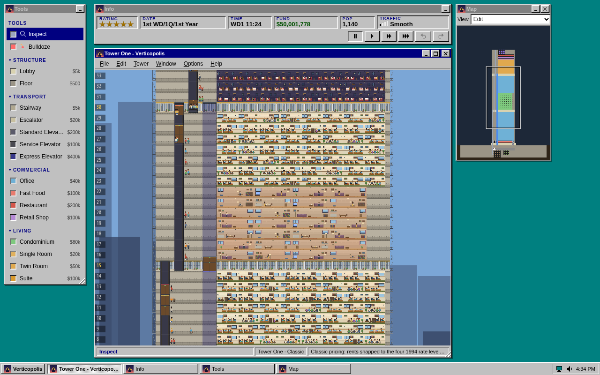
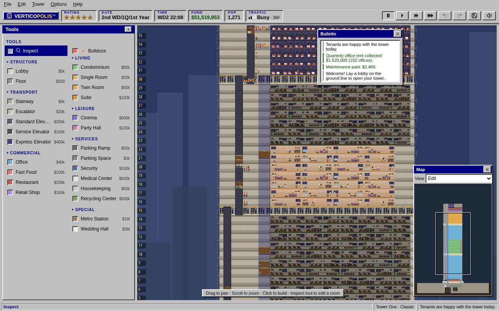
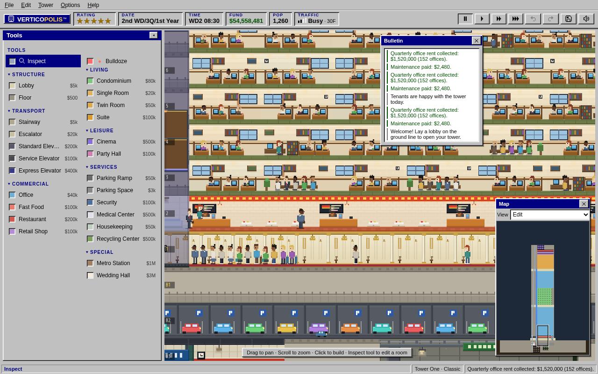
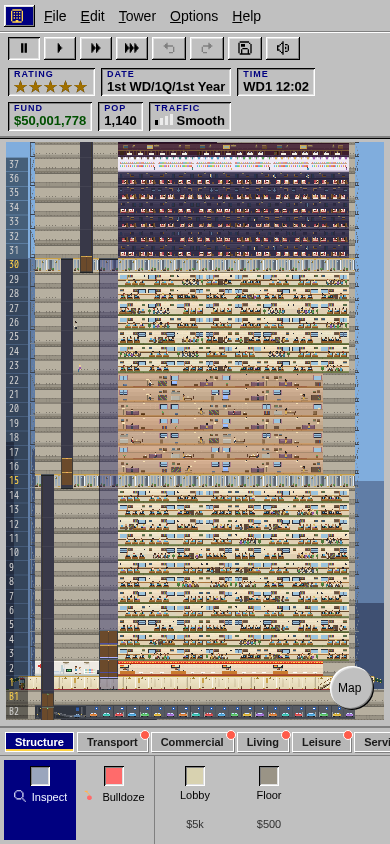

# Verticopolis™

**Build a tower floor by floor, right in your browser.**
[Play at verticopolis.com](https://verticopolis.com) ·
[How to play](https://verticopolis.com/help/) ·
[Engine docs](https://docs.verticopolis.com/) ·
[Release notes](https://verticopolis.com/help/changelog/)

Verticopolis™ is a free, open-source tower sim, a from-scratch homage to the
1994 classic SimTower. Start on an empty lot, add offices, homes, hotels, shops
and restaurants, wire it all together with stairs, escalators and elevators,
set the rents, keep your tenants happy, and climb the star ratings to the
coveted **TOWER**.

- **Two ways to play.** *Classic* plays the 1994 game rule for rule. *Modern*
  keeps all of it and adds new rooms, rental homes, a gentler calendar and
  smarter elevator tools. ([Classic and Modern](https://verticopolis.com/help/classic-vs-modern/))
- **A living tower** on one game clock: rush hours, quiet nights, people riding
  the cars, lights in the windows, the metro train pulling in.
- **Your towers, kept:** autosave, save slots, `.vctower` files, and the
  original game's `.TDT` saves.
- **Installable and offline** on desktop and phone.

  

  
  

## Under the hood

The simulation is a **Rust** engine compiled to **WebAssembly**, and it is the
only engine the game runs. Around it, the game is **TypeScript** on the
[Excalibur.js](https://excaliburjs.com/) game engine, with a procedural
soundtrack built on [Tone.js](https://tonejs.github.io/). There are no external
art assets: every sprite is drawn in code.

## Repositories

| Repository | What it holds |
| --- | --- |
| [Verticopolis/web](https://github.com/Verticopolis/web) | The game at [verticopolis.com](https://verticopolis.com) and its player's manual. **Start here** to report a bug, suggest an idea or contribute. |
| [Verticopolis/engine](https://github.com/Verticopolis/engine) | The Rust simulation engine (the `verticopolis-engine` crate), its WebAssembly package `@verticopolis/engine`, the conformance suite and the [engine docs](https://docs.verticopolis.com/). |
| [Verticopolis/components](https://github.com/Verticopolis/components) | `@verticopolis/components`: the renderer, the Windows 95 windows and menus, the procedural sprites and audio, and the engine binding a frontend builds on. |

The game builds on the components, and both run the engine. Each repository
was split out of the game's with its full history, so `git log` and
`git blame` still reach every line's first commit. For a few more days, while
the game switches over to the published packages, engine and component
changes are on hold; issues are welcome in every repository now.

  

## License

The **source code** in every repository is [MIT](https://github.com/Verticopolis/web/blob/main/LICENSE).
The original **art and audio** are [CC BY 4.0](https://github.com/Verticopolis/web/blob/main/ASSETS-LICENSE.md).

The Verticopolis™ name and logo are trademarks of the Verticopolis project.
Neither license grants permission to use them; you may fork and share the code,
but please give your version its own name. Verticopolis is built clean-room,
uses none of the original game's code or assets, and is not affiliated with or
endorsed by the makers of SimTower.
